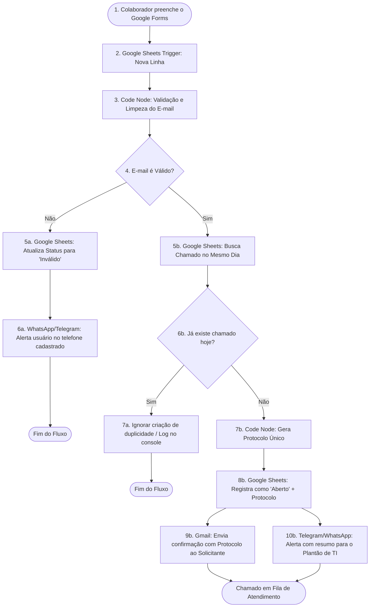

# 🛠️ Sistema Automatizado de Gestão de Chamados de TI com n8n

[](https://n8n.io/)
[](https://www.google.com/forms/about/)
[](https://www.google.com/sheets/about/)
[](https://mail.google.com/)
[](https://telegram.org/)
[](LICENSE)

> Solução low-code para automação, triagem, validação e roteamento de tickets de suporte técnico interno. Integra formulários, planilha como banco de dados relacional leve, auditoria de protocolos únicos e comunicação multicanal.

---

## 📌 Sumário
1. [Sobre o Projeto](#-sobre-o-projeto)
2. [Arquitetura e Fluxo de Dados](#-arquitetura-e-fluxo-de-dados)
3. [Nós do n8n Utilizados](#-nós-do-n8n-utilizados)
4. [Guia de Criação Passo a Passo no n8n](#-guia-de-criação-passo-a-passo-no-n8n)
5. [Regras de Negócio e Tratamento de Exceções](#-regras-de-negócio-e-tratamento-de-exceções)
6. [Estrutura da Base de Dados (Google Sheets)](#-estrutura-da-base-de-dados-google-sheets)
7. [Como Configurar e Executar](#-como-configurar-e-executar)
8. [Roadmap e Futuras Melhorias](#-roadmap-e-futuras-melhorias)
9. [Autor e Contato](#-autor-e-contato)

---

## 🎯 Sobre o Projeto

Em ambientes corporativos, a abertura desordenada de chamados por e-mails soltos, mensagens de chat ou formulários não tratados gera:
- Falta de controle sobre o volume real de solicitações.
- Tickets duplicados para o mesmo problema.
- Erros de digitação em e-mails que impedem o retorno ao colaborador.
- Falta de numeração de protocolo para auditoria e acompanhamento de SLA.

Este projeto orquestra um fluxo de trabalho inteligente no **n8n** que assume todo o processamento de ponta a ponta: desde a captura da requisição até a notificação em tempo real da equipe responsável.

---

## 📐 Arquitetura e Fluxo de Dados



---

## 🧩 Nós do n8n Utilizados

| # | Nome do Nó | Tipo no n8n | Responsabilidade |
|---|---|---|---|
| **01** | `Google Sheets Trigger` | Trigger Node | Monitora a planilha vinculada ao formulário a cada nova linha inserida. |
| **02** | `Validate Email` | Code (JavaScript) | Aplica regex para conferir integridade do e-mail e sanitiza campos de texto. |
| **03** | `If - Email Valid?` | If Node | Bifurca o workflow: segue fluxo de atendimento ou rota de contingência. |
| **04** | `Update as Invalid` | Google Sheets | Marca o chamado na planilha como `Inválido` para fins estatísticos. |
| **05** | `Notify User via Phone` | WhatsApp / Telegram / HTTP | Dispara mensagem para o telefone do usuário orientando sobre o erro no e-mail. |
| **06** | `Check Duplicates` | Google Sheets | Consulta chamados existentes filtrando por solicitante e data atual. |
| **07** | `If - Is Duplicate?` | If Node | Interrompe o fluxo se já existir chamado do mesmo usuário na data atual. |
| **08** | `Generate Protocol` | Code (JavaScript) | Gera protocolo único determinístico/aleatório (`TI-YYYYMMDD-XXXX`). |
| **09** | `Update Sheet as Open` | Google Sheets | Escreve o protocolo e atualiza o status para `Aberto`. |
| **10** | `Send Email to User` | Gmail Node | Dispara e-mail com template HTML contendo protocolo e instruções. |
| **11** | `Alert IT Team` | Telegram Node | Envia mensagem para o grupo de suporte com detalhes da ocorrência. |

---

## 🔨 Guia de Criação Passo a Passo no n8n

Se você deseja construir este fluxo manualmente na sua instância, siga as etapas abaixo:

### Etapa 1: Captura e Gatilho
1. Adicione o nó **Google Sheets Trigger**.
2. Em **Poll Times**, defina a checagem (ex: a cada 1 minuto).
3. Selecione o documento da planilha do formulário e a aba `Respostas ao formulário 1`.
4. Evento: `Row Added`.

---

### Etapa 2: Validação de E-mail (Code Node)
1. Adicione um nó **Code** nomeado como `Validate Email`.
2. Modo: `Run Once for Each Item`.
3. Insira o seguinte código JavaScript:

```javascript
const rawEmail = $input.item.json['E-mail'] || '';
const cleanEmail = rawEmail.trim().toLowerCase();

// Expressão regular para validação de formato de e-mail padrão RFC 5322 simplificado
const emailRegex = /^[a-zA-Z0-9._%+-]+@[a-zA-Z0-9.-]+\.[a-zA-Z]{2,}$/;
const isValid = emailRegex.test(cleanEmail);

// Captura data atual no formato YYYY-MM-DD para checagem de duplicidade
const today = new Date().toISOString().split('T')[0];

return {
  ...$input.item.json,
  emailSanitized: cleanEmail,
  isEmailValid: isValid,
  requestDate: today
};
```

---

### Etapa 3: Roteamento de Validação (If Node)
1. Adicione um nó **If**.
2. Condição:
   - **Value 1:** `{{ $json.isEmailValid }}`
   - **Operation:** `is equal to`
   - **Value 2:** `true` (tipo booleano).
3. **Saída `false`:** Conecte ao nó que atualiza a planilha com `Status = Inválido` e, em seguida, chame a notificação para o telefone informado via WhatsApp (Evolution API / Z-API) ou SMS.

---

### Etapa 4: Prevenção de Duplicidade (Google Sheets + If)
1. Conecte a saída `true` do If anterior a um novo nó **Google Sheets**.
2. Operação: `Get Many Rows`.
3. Adicione filtro:
   - `E-mail` **Equals** `{{ $json.emailSanitized }}`
   - `Data` **Contains** `{{ $json.requestDate }}`
   - `Status` **Not Equal** `Inválido`
4. Em seguida, conecte um nó **If**:
   - Condição: O total de linhas encontradas é maior que 1? (ou seja, já havia registro prévio hoje).
   - Se **sim**, encerre a execução para evitar tickets repetidos.
   - Se **não**, siga para a geração de protocolo.

---

### Etapa 5: Geração de Protocolo Único (Code Node)
1. Adicione um nó **Code** com o nome `Generate Protocol`.
2. Código:

```javascript
const now = new Date();
const year = now.getFullYear();
const month = String(now.getMonth() + 1).padStart(2, '0');
const day = String(now.getDate()).padStart(2, '0');
const randomHash = Math.floor(1000 + Math.random() * 9000);

const protocolNumber = `TI-${year}${month}${day}-${randomHash}`;

return {
  ...$input.item.json,
  protocol: protocolNumber,
  status: 'Aberto',
  createdAtFormatted: now.toLocaleString('pt-BR')
};
```

---

### Etapa 6: Persistência e Notificações Finais
1. **Google Sheets (Update Row):**
   - Atualiza a linha com as colunas `Protocolo` = `{{ $json.protocol }}` e `Status` = `Aberto`.
2. **Gmail Node:**
   - **To:** `{{ $json.emailSanitized }}`
   - **Subject:** `[Chamado Recebido] Protocolo: {{ $json.protocol }}`
   - **Email Type:** HTML
   - **Message:**
     ```html
     <h3>Olá, {{ $json.Nome }}!</h3>
     <p>Seu chamado foi registrado com sucesso em nossa central de TI.</p>
     <p><strong>Número de Protocolo:</strong> {{ $json.protocol }}</p>
     <p><strong>Descrição informada:</strong> {{ $json['Descrição do Problema'] }}</p>
     <p>Nossa equipe entrará em contato em até 4 horas úteis.</p>
     ```
3. **Telegram Node:**
   - **Chat ID:** `ID_DO_GRUPO_TI`
   - **Text:**
     ```text
     🔔 NOVO CHAMADO DE SUPORTE
     ──────────────────────────
     📋 Protocolo: {{ $json.protocol }}
     👤 Solicitante: {{ $json.Nome }}
     🏢 Departamento: {{ $json.Departamento }}
     ⚠️ Problema: {{ $json['Descrição do Problema'] }}
     📅 Data/Hora: {{ $json.createdAtFormatted }}
     ──────────────────────────
     Status: Aberto 🟢
     ```

---

## 📋 Regras de Negócio e Tratamento de Exceções

1. **E-mails com Erro de Sintaxe:**  
   Colaboradores que digitarem e-mails inexistentes ou incompletos (ex: `joao@` ou `maria@empresa`) são desviados imediatamente. A equipe de TI não perde tempo tentando responder um destinatário inacessível, e o usuário recebe um aviso pelo número de telefone cadastrado.

2. **Filtro Anti-Flood (Duplicidade no mesmo dia):**  
   Muitos usuários abrem chamados repetidos a cada 10 minutos por ansiedade. A automação identifica que já existe um ticket em aberto naquele dia pelo mesmo usuário e evita inflar a métrica da equipe.

3. **Geração Determinística de Protocolo:**  
   Cada chamado possui identificação única no formato `TI-[ANO][MÊS][DIA]-[SUFIXO]`, o que permite fácil indexação e busca na planilha.

---

## 📊 Estrutura da Base de Dados (Google Sheets)

| Coluna | Tipo | Obrigatório | Descrição |
|---|---|:---:|---|
| `Carimbo de data/hora` | DateTime | Sim | Data e hora gerada pelo Google Forms |
| `Nome` | String | Sim | Nome completo do solicitante |
| `E-mail` | String | Sim | E-mail para contato e SLA |
| `Telefone` | String | Sim | Telefone/Ramal para contingência |
| `Departamento` | String | Sim | Setor (Financeiro, RH, Operações, etc.) |
| `Descrição do Problema`| String | Sim | Detalhamento da falha |
| `Protocolo` | String | Não | Inserido pelo n8n (`TI-YYYYMMDD-XXXX`) |
| `Status` | Enum | Sim | `Aberto`, `Inválido`, `Em Andamento`, `Fechado` |

---

## 🚀 Como Configurar e Executar

### Pré-requisitos
- Instância do **n8n** rodando (versão 1.x recomendada).
- Conta no **Google Cloud Console** com as APIs ativadas:
  - *Google Sheets API*
  - *Gmail API*
  - Credencial OAuth2 configurada no n8n.
- Bot no **Telegram** criado com o [@BotFather](https://t.me/BotFather) e adicionado ao grupo da equipe de suporte com privilégios de envio de mensagem.

### Instalação
1. Clone este repositório:
   ```bash
   git clone https://github.com/seu-usuario/n8n-suporte-ti.git
   ```
2. Crie uma planilha no Google Sheets com as colunas especificadas acima.
3. No n8n, crie um novo workflow e clique em **Workflow Settings > Import from File**.
4. Selecione o arquivo `workflow/workflow-chamados-ti.json`.
5. Substitua as credenciais pelas suas contas do Google e token do Telegram.
6. Clique em **Publish / Active** para ligar a automação.

---

## 🔮 Roadmap e Futuras Melhorias

- [ ] **Classificação Inteligente com IA (LLM):** Integrar nó da OpenAI ou Gemini para analisar a descrição do chamado e atribuir automaticamente a categoria de prioridade (`Baixa`, `Média`, `Alta`, `Crítica`).
- [ ] **SLA Dinâmico:** Calcular e salvar a data limite de atendimento com base na criticidade da solicitação.
- [ ] **Integração com Jira / GLPI:** Criar o ticket em ferramentas formais de ITSM caso a empresa utilize software dedicado.
- [ ] **Dashboard de Métricas:** Conectar o Google Sheets ao Looker Studio ou Power BI para exibir métricas em tempo real (tempo médio de resposta, chamados por setor).
- [ ] **Pesquisa de Satisfação (CSAT):** Disparar mensagem de avaliação após o chamado mudar para status `Fechado`.

---

## 📄 Licença

Este projeto está sob a licença [MIT](LICENSE) - sinta-se livre para usar, modificar e distribuir.

